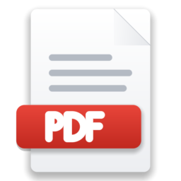
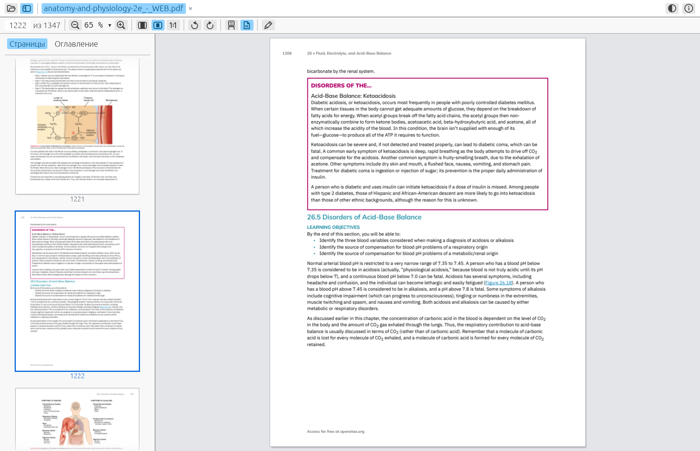

<p align="center">
  
</p>

<h1 align="center">MetalPDF</h1>

<p align="center">Быстрый просмотрщик PDF для Windows</p>

<p align="center">
  <a href="https://github.com/Fan4Metal/metalpdf/releases/latest"></a>
  
  
  <a href="LICENSE"></a>
</p>

<p align="center"><a href="README.md">English</a> | <b>Русский</b></p>

MetalPDF — просмотрщик PDF, построенный вокруг одной идеи: документ должен быть на экране в момент появления окна, а при пролистывании никогда не должно быть пустых страниц. Он рисует страницы движком PDFium (движок PDF из Chromium), открывает документы во вкладках, которые можно вытащить в отдельные окна, ищет по тексту, выделяет текст, показывает миниатюры и оглавление, а также умеет изменить текст строки и сохранить результат. В программе нет диалога настроек и нет обращений в сеть, кроме необязательной проверки обновлений.



*Снимок окна версии 0.1.0.*

## Возможности

- **Мгновенно**: первая страница рисуется, пока окно ещё создаётся; учебник на 450 МБ и 1300 страниц открывается менее чем за 10 мс, а его первая страница оказывается на экране примерно через 160 мс после запуска программы (см. [Производительность](#производительность)).
- **Без пустых страниц**: страницы, к которым прокручивают, рисуются из ближайшего имеющегося рендера или маленького превью, пока не придёт точный; рендеры, которых уже никто не ждёт, прерываются на полпути.
- **Вкладки и окна**: несколько документов в одном окне, вытащенная вкладка становится окном; повторный запуск передаёт файлы работающей копии; последний сеанс открывается заново (см. [Вкладки и окна](#вкладки-и-окна)).
- **Непрерывная прокрутка или по одной странице**, по ширине, страница целиком или любой масштаб, повороты на четверть оборота, клавиатура просмотрщика (см. [Горячие клавиши](#горячие-клавиши)).
- **Боковая панель** с миниатюрами страниц и оглавлением документа; обе следуют за читаемой страницей.
- **Поиск** по всему документу с подсветкой найденного на страницах; **выделение текста** мышью, копирование по Ctrl+C.
- **Ссылки** внутри документа и в веб, с историей для возврата.
- **Правка** (экспериментально): текст строки меняется на месте, изображения перемещаются, масштабируются, заменяются и удаляются, страницы вставляются, заменяются и удаляются, документ сохраняется (см. [Правка текста, изображений и страниц](#правка-текста-изображений-и-страниц)).
- **Формы** рисуются вместе с содержимым полей; **зашифрованные** документы запрашивают пароль.
- **Светлая, тёмная или системная тема.**
- **Русский или английский интерфейс**: следует языку Windows и меняется в окне «О программе» (`F1`).
- **Портативность**: [портативный архив](#установка) хранит настройки рядом с программой.
- **Конфиденциальность**: никаких обращений в сеть, кроме необязательной проверки обновлений (см. [Проверка обновлений и конфиденциальность](#проверка-обновлений-и-конфиденциальность)).

## Установка

Установщик и портативный архив лежат на странице [Releases](https://github.com/Fan4Metal/metalpdf/releases).

Установщик `MetalPDF_<версия>_Setup.exe` не требует прав администратора: программа помещается в `%LOCALAPPDATA%\Programs\MetalPDF` и предлагается для файлов PDF в меню «Открыть с помощью» и в Параметрах → Приложения по умолчанию (программой по умолчанию она сама себя не делает). Установленная программа хранит настройки в `%APPDATA%\MetalPDF\config\settings.json`.

Портативный архив `MetalPDF_<версия>_portable.zip` содержит программу в папке `MetalPDF` и работает без установки. В нём также лежит пустой файл `metalpdf.json`. Пока этот файл находится рядом с `metalpdf.exe` и папка доступна для записи, настройки хранятся в нём, так что программу можно носить на съёмном диске. Без файла программа хранит их в `%APPDATA%\MetalPDF`, как и установленная. Окно «О программе» показывает, где хранятся настройки.

В обоих случаях рядом с программой лежит `pdfium.dll` — движок рендеринга; без него программа запускается и сообщает, чего не хватает.

Windows SmartScreen может предупредить о неподписанной программе при первом запуске: «Подробнее» → «Выполнить в любом случае».

## Использование

PDF открывается через `Ctrl+O`, перетаскиванием на окно, из списка недавних файлов на стартовом экране, из Проводника (двойным щелчком, если MetalPDF выбран для файлов PDF, или через «Открыть с помощью») либо из командной строки: `metalpdf.exe файл.pdf`. Каждый файл открывается во вкладке; уже открытый файл просто выводится вперёд.

На панели инструментов под вкладками находятся поле страницы (введённый туда номер страницы или метка вроде `iv` ведёт на эту страницу; `Ctrl+G` ставит в него курсор), масштаб с меню, три пресета масштаба (по ширине, страница целиком, истинный размер; действующий подсвечен, а выбранный пресет становится масштабом, с которым открываются новые документы), две кнопки поворота, режим просмотра (непрерывно или по одной странице, где полоса прокрутки по-прежнему охватывает весь документ, а её перетаскивание листает страницы) и карандаш режима правки; заметка справа сообщает об отказе в правке или о сохранении файла. В строке вкладок — «Открыть», переключатель боковой панели, вкладки, а справа переключатель темы, кнопка обновления, когда вышла новая версия, и «О программе».

Место, где оставлен каждый документ (страница, масштаб, повороты), запоминается, как и последний сеанс: запущенный без файлов, MetalPDF открывает вкладки, с которыми был закрыт.

### Вкладки и окна

Вкладки переключаются по `Ctrl+Tab` и `Ctrl+Shift+Tab`, закрываются по `Ctrl+W` или крестиком, открываются заново по `Ctrl+Shift+T`, а перетаскиванием меняют порядок. Вкладка, вытащенная из строки вкладок, становится отдельным окном; перетащенная на другое окно MetalPDF — переезжает туда. Контекстное меню вкладки предлагает то же самое и «Закрыть остальные».

На сеанс пользователя работает одна копия MetalPDF: повторный запуск (двойной щелчок в Проводнике, командная строка) передаёт файлы работающей копии, которая открывает их в последнем использованном окне и выходит на передний план. `metalpdf.exe --new-instance файл.pdf` запускает отдельную копию.

### Боковая панель

`F4` (или кнопка рядом с «Открыть») показывает панель с тремя списками. **Страницы** — все страницы в виде миниатюр; текущая обведена и удерживается на виду, щелчок ведёт на страницу. **Оглавление** — закладки документа деревом: уровни различаются размером, насыщенностью и отступом с направляющими линиями, у каждой закладки номер страницы; главы свёрнуты, кроме той, где находится читатель, а его закладка подсвечена; щелчок переходит к закладке, щелчок по треугольнику сворачивает или разворачивает её. **Поиск** — находки поиска. Ширина панели запоминается.

### Поиск

`Ctrl+F` открывает строку поиска. Поиск начинается с читаемой страницы и обходит документ по кругу, страница за страницей; найденное подсвечивается на страницах, текущее совпадение — ярче, а строка показывает, которое это совпадение из скольких (со знаком плюс, пока поиск продолжается). `Enter` и `F3` ведут к следующему совпадению, `Shift+F3` — к предыдущему; `Aa` и <u>ab</u> включают учёт регистра и поиск только целых слов; `Esc` закрывает строку. Вкладка «Поиск» боковой панели перечисляет находки по страницам, каждую в её строке, совпадение выделено цветом; щелчок ведёт к ней. Начало поиска открывает боковую панель на этой вкладке; закрытие поиска возвращает панель в прежнее состояние.

Правая кнопка над страницами открывает меню: копировать выделение, выделить страницу, скопировать картинку под указателем (в буфер обмена, в её собственном разрешении, как показана: с масками и прозрачностью), открыть ссылку или скопировать её адрес, инструменты, а в режиме правки — отрезок текста или картинку под указателем. На панели инструментов два инструмента: с текстовым (`V`) протягивание выделяет текст, с рукой (`H`) — прокручивает страницы. Двойной щелчок выделяет слово под указателем при любом из них.

Когда напечатанные на страницах номера отличаются от номеров в файле (скажем, страница 1 книги — семнадцатая в файле), правая кнопка на поле номера страницы предлагает прочитать напечатанные номера со страниц (берутся две дюжины страниц, принимается сдвиг, с которым они согласны), указать номер показанной страницы или вернуться к нумерации файла. Поле номера, миниатюры, оглавление и список находок после этого показывают напечатанные номера (страницы до первой — римскими цифрами, как вводная часть книги), введённый в поле номер понимается как напечатанный, а настройка хранится вместе с позицией в документе. Документ с собственными метками страниц (например, римскими номерами предисловия) показывает их как есть.

### Выделение текста и ссылки

Текст выделяется протягиванием мыши, в том числе через несколько страниц, и копируется по `Ctrl+C`; `Ctrl+A` выделяет текст текущей страницы, `Esc` снимает выделение. Над текстом указатель принимает вид I-образного курсора, над ссылкой — руки; ссылка внутри документа ведёт к цели, веб-ссылка открывается в браузере. `Alt+←` (или кнопка «назад» на мыши) возвращает из перехода по ссылке, закладке, миниатюре, полю страницы или совпадению; `Alt+→` повторяет переход.

### Правка текста, изображений и страниц

Режим правки (`E` или карандаш на панели инструментов) обводит текстовые объекты страниц — отрезки текста, из которых состоит PDF: обычно строка или её часть. Щелчок по отрезку открывает над ним поле; `Enter` заменяет текст отрезка, `Esc` оставляет как было. `Ctrl+Z` отменяет последнее изменение. Вёрстка страниц не меняется: более длинный текст выходит за то место, где кончался старый, ничего не переносится.

Отрезок сохраняет свой шрифт, а с ним и вид, всякий раз, когда этот шрифт способен показать новый текст; шрифт, встроенный как подмножество глифов, способен на это для символов, которые в нём есть (скажем, цифр даты). Лишь когда глифа нет, отрезок набирается подменным шрифтом на том же месте, того же размера и цвета: тем же шрифтом, если он установлен на компьютере (он ищется по имени из документа среди шрифтов Windows и пользователя), иначе Arial, Times New Roman или Courier New по виду исходного, в его насыщенности и наклоне, так что жирный отрезок остаётся жирным; и подогнанным по ширине исходного отрезка, так что правка той же длины занимает ту же рамку. Отрезок под указателем показывает свой шрифт и размер и установлен ли этот шрифт: если нет, его установка сделает замену точной.

Изображения тоже обводятся. Щелчок выделяет изображение: его перемещают перетаскиванием, а размер меняют за угловые маркеры (пропорции сохраняются); кнопка **«Заменить…»** ставит на его место файл JPEG или PNG, вписанный в прежнюю рамку с собственными пропорциями, а **«Удалить»** (или клавиша `Del`) убирает его.

Страницами управляют из контекстного меню миниатюры в боковой панели: вставить перед ней или после неё пустую страницу (размером с соседнюю) либо все страницы другого файла PDF, заменить страницу страницами другого PDF, удалить страницу (последняя остаётся). Режим правки для этого не нужен.

Изменения живут в копии документа, пока `Ctrl+S` не сохранит её (через диалог «Сохранить как», так что оригинал заменяется только по выбору); закрытие вкладки или выход с несохранёнными изменениями сначала спрашивает. Подписанные и зашифрованные документы не редактируются. В тегированном (доступном) документе доступны только операции со страницами: перезапись содержимого страницы потеряла бы отметки, на которые ссылаются теги; структура тегов при вставке и удалении страниц не обновляется. Текст и изображения внутри Form XObject, куда некоторые генераторы кладут всю страницу, недоступны. Отказ в правке объясняется в строке состояния. Эта часть программы экспериментальна; для ценного документа лучше работать с копией.

## Горячие клавиши

| Клавиши | Действие |
|---|---|
| `Ctrl+O` | Открыть файл |
| `Ctrl+W`, `Ctrl+Shift+T` | Закрыть вкладку, открыть заново последнюю закрытую |
| `Ctrl+Tab`, `Ctrl+Shift+Tab` | Следующая, предыдущая вкладка |
| `Page Down`, `Page Up`, `Space`, `Shift+Space` | Экран вниз или вверх (в постраничном режиме в конце — следующая или предыдущая страница) |
| Колесо мыши | Прокрутка; в постраничном режиме щелчок колеса листает страницу (страница выше окна сначала прокручивается) |
| `Ctrl+Page Down`, `Ctrl+Page Up`, `N`, `P` | Следующая, предыдущая страница |
| `Home`, `End` | Первая, последняя страница |
| `←` `↑` `→` `↓` | Прокрутка (в постраничном режиме `←` `→` листают страницы) |
| `Ctrl+G` | Поле страницы |
| `Ctrl+0`, `Ctrl+1`, `Ctrl+2` | По ширине, 100 %, страница целиком |
| `Ctrl++`, `Ctrl+−`, `Ctrl+колесо` | Увеличить, уменьшить (колесом — вокруг указателя) |
| `R`, `Shift+R` | Повернуть страницы вправо, влево |
| `V`, `H` | Текстовый инструмент (протягивание выделяет), рука (протягивание прокручивает) |
| `F4` | Боковая панель |
| `Ctrl+F`, `F3`, `Shift+F3`, `Esc` | Поиск, следующее, предыдущее совпадение, закрыть |
| `Ctrl+C`, `Ctrl+A`, `Esc` | Копировать выделение, выделить страницу, снять выделение |
| `Alt+←`, `Alt+→` | Назад, вперёд по переходам |
| `E`, `Ctrl+Z`, `Ctrl+S`, `Del` | Режим правки, отменить правку, сохранить как, удалить выделенное изображение |
| `F11` | Полный экран |
| `F1` | О программе (версия, язык, проверка обновлений, лицензии) |

## Производительность

Измерено на i7-13700KF с RTX 4070 Ti SUPER и дисплеем 4K при масштабе 150 % командой `metalpdf.exe --bench файл.pdf` (только движок) и с `METALPDF_TRACE=1` (окно):

| Шаг | Время |
|---|---|
| Загрузка и инициализация `pdfium.dll` | 2 мс |
| Открытие файла на 2 страницы; учебника на 454 МБ и 1347 страниц | 0,2 мс; 9 мс |
| Чтение размеров всех 1347 страниц | 16 мс |
| Рендер текстовой страницы шириной 1626 px; страницы с большими изображениями | 3–5 мс; 17 мс |
| Превью страницы шириной 200 px | 0,1–3 мс |
| Первая страница на экране (загружена в GPU) после запуска программы | 160 мс |
| Показ окна | 210–250 мс |

Поток движка открывает первый файл и рисует его первую страницу, пока создаётся окно, в размере, предсказанном по сохранённому окну, так что первый кадр застаёт страницу готовой. Первый запуск на машине медленнее: DLL читается с диска.

## Проверка обновлений и конфиденциальность

MetalPDF не обращается в сеть, за одним исключением: проверка обновлений, **выключенная по умолчанию**. Если её включить в окне «О программе» (`F1`), программа раз в сутки при запуске и по кнопке «Проверить сейчас» спрашивает у `api.github.com` последний выпуск этого репозитория; запрос несёт в себе имя и версию программы в качестве user agent и ничего больше, и ничего не скачивается. Новая версия показывается кнопкой в строке вкладок, которая открывает страницу выпуска в браузере. Открытые документы, недавние файлы и настройки никогда не покидают компьютер.

## Сборка

Требуются Rust (stable, MSVC), Visual Studio 2022 Build Tools (рабочая нагрузка C++), Python 3 и [uv](https://docs.astral.sh/uv/); для установщика — Inno Setup 6.

```
uv run build.py
```

Скрипт закрывает `metalpdf.exe`, запущенный из `target\`, скачивает закреплённую `pdfium.dll` в `vendor\pdfium`, если её нет (`tools\get_pdfium.py`, с проверкой SHA-256), и выполняет `cargo build --release`; сборка копирует DLL рядом с `target\release\metalpdf.exe`. `cargo test` выполняет модульные тесты; `cargo test pdfium -- --ignored --test-threads=1` задействует и DLL (PDF, написанный тестом, открывается, рисуется, читается, правится и сохраняется). `metalpdf.exe --bench файл.pdf` печатает тайминги движка для файла.

<details>
<summary>Настройка окружения через winget</summary>

```
winget install Rustlang.Rustup Microsoft.VisualStudio.2022.BuildTools astral-sh.uv Python.Python.3.13 JRSoftware.InnoSetup
rustup default stable-msvc
```

Для Build Tools в Visual Studio Installer выбирается рабочая нагрузка «Разработка классических приложений на C++».

</details>

<details>
<summary>Раскладка исходников</summary>

- `src/pdfium/` — C API PDFium, объявленный вручную (`sys.rs`), и безопасный слой над ним (`mod.rs`): документы, страницы, рендер (обычный и прогрессивный), текст, поиск, ссылки, закладки, правка, сохранение.
- `src/engine.rs` — единственный поток, из которого вызывается PDFium, с планировщиком рендеров.
- `src/layout.rs`, `src/view.rs` — геометрия страниц и состояние вида.
- `src/app.rs` — окна и вкладки; `src/ui/` — область страниц, строка вкладок, панель инструментов, боковая панель, «О программе», окно лицензий, нарисованные иконки.
- `src/settings.rs` — настройки в JSON; `src/single_instance.rs` — передача файлов между запусками.
- `tools/` — `get_pdfium.py`, `make_release.py`, `notices.py`, `setup.iss`.

</details>

## Установщик и выпуск

```
python tools\make_release.py                        # тесты, сборка, dist\MetalPDF_<версия>_Setup.exe и _portable.zip
python tools\make_release.py --no-tests --install   # то же, затем тихая установка поверх установленной копии
```

Workflow GitHub собирает оба файла при push тега `vX.Y.Z` (он должен совпадать с версией в `Cargo.toml`) и публикует их как выпуск.

## Используемые проекты

- [PDFium](https://pdfium.googlesource.com/pdfium/) — движок PDF из Chromium в сборке [pdfium-binaries](https://github.com/bblanchon/pdfium-binaries).
- [egui / eframe](https://github.com/emilk/egui) — интерфейс.
- [interprocess](https://github.com/kotauskas/interprocess) — канал между запусками; [rfd](https://github.com/PolyMeilex/rfd) — файловые диалоги; [serde](https://serde.rs) — настройки.

## Лицензия

MIT, см. [LICENSE](LICENSE). PDFium и библиотеки, собранные в `pdfium.dll`, распространяются под лицензией BSD 3-Clause и другими разрешительными лицензиями, крейты Rust и шрифты, скомпилированные в `metalpdf.exe`, — тоже под разрешительными лицензиями: см. [THIRD_PARTY_LICENSES.md](THIRD_PARTY_LICENSES.md), [licenses/PDFium-LICENSE.txt](licenses/PDFium-LICENSE.txt) и [licenses/THIRD_PARTY_NOTICES.txt](licenses/THIRD_PARTY_NOTICES.txt); программа показывает их в «О программе» → «Лицензии…».
